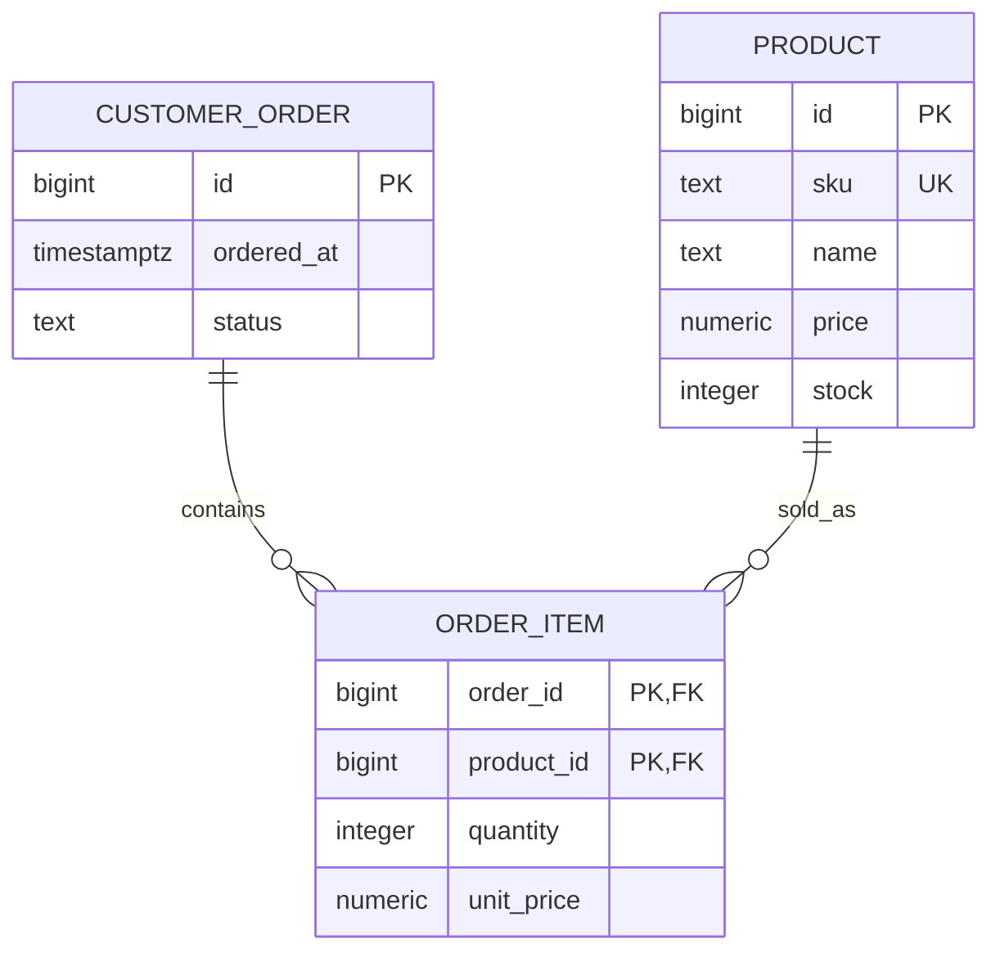

# Inventory ERD

The schema permits empty orders through direct writes; place_order creates one line atomically. Template for extensions: show customer and movement-ledger relationships as you implement them.
